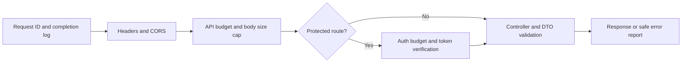

# Architecture

The [decision log](DECISIONS.md) records why these boundaries exist. Follow [coding rules](../CONTRIBUTING.md), [game-config conventions](GAME_CONFIG.md) and the [environment runbook](RUNBOOK.md) when extending them.

## Responsibilities

React owns the application interface. React Router supplies home (`/`), pond preview (`/play`), account (`/account`), and a catch-all 404. `AppShell` keeps navigation and server status mounted between pages. Page modules load lazily with a Suspense loading state and an error boundary that resets on navigation. A separate outer boundary protects the shell itself.

Phaser 3 owns the canvas and future world presentation. Visiting `/play` loads the engine; it is not loaded on the home page. React mounts and destroys one Phaser instance with its game viewport. A loading overlay remains until Phaser's post-boot callback. Async import/startup failures become render errors handled by the nearest boundary. The foundation scene contains text only; world assets and movement start in Phase 1.

The shell includes active navigation, a skip link, main-content focus and document-title updates on navigation, live status announcements, visible keyboard focus, fluid typography, narrow-screen layouts, and reduced-motion support. Server health checks time out after five seconds; offline status offers a manual reconnect while navigation remains available.

NestJS owns gameplay decisions and validates request DTOs through a global validation pipe. `AppModule` composes Auth, Player and health modules; Player/health modules share `DatabaseModule`. Application routes use `/api/v1/...`; a global exception filter provides consistent JSON errors and hides internal server details. A global guard verifies Supabase access tokens; explicit public routes cover probes and API identity. Player endpoints resolve only the verified caller. See the [API guide](API.md) and [authentication](AUTHENTICATION.md). Gameplay/economic endpoints remain future work.

Prisma connects NestJS to Supabase PostgreSQL through one bounded `pg.Pool` per API process. Runtime and migration logins are distinct. PostgreSQL, the private media bucket and Supabase Auth are connected to the dedicated development project. Realtime behavior remains future work. See the [infrastructure guide](../deployment/supabase/README.md).

## Boundaries

- `apps/web/src/features` contains domain UI; `components`, `hooks`, `lib`, `stores`, and `styles` hold shared concerns.
- `apps/web/src/game` contains Phaser scenes and engine lifecycle code.
- `apps/web/src/app` contains routing and the persistent layout; `pages` contains route views; `components` contains shared error, loading and status views.
- `apps/api/src/modules` reserves feature modules; `config`, `database`, `health`, and `common` hold server infrastructure.
- `packages/shared` contains runtime API schemas and inferred types, avoiding duplicate type packages.
- `packages/game-config` currently contains presentation settings only. Never put secrets or authoritative hidden probabilities in a browser-imported package.
- `packages/typescript-config` holds compiler defaults; lint rules live at the root until multiple distinct configurations are needed.

The private schema defines Player identity and, in the locally verified 00.08 migration, append-only AuditEvent history. Player ownership uses an internal UUID; audit IDs are historical snapshots. There are no Gold or gameplay inventory fields. Introduce economic models and transactional operations in their corresponding phases. The hosted 00.08 rollout remains pending; see [database foundations](DATABASE.md).

## Request monitoring and security

`ObservabilityModule` supplies structured JSON logging, request correlation and the replaceable safe error-reporting hook. `SecurityModule` supplies independent API and Auth-verification rate stores. Request correlation/header middleware runs before CORS, body parsing and handlers; rate/proxy settings are validated at startup. Public probes bypass the API budget. See [monitoring and security](SECURITY.md) for field privacy, process-failure behavior, per-process limits and production dependencies.

## Environment and credentials

Mode-specific loaders isolate development, test and production. The API validates startup inputs before creating the server and rejects administrative credentials in its runtime. The browser explicitly receives only validated public configuration. CORS compares exact allowed origins and returns 403 for unlisted requests/preflights. See [configuration and secret management](CONFIGURATION.md).

`GET /health` reports API liveness. `GET /ready` executes `SELECT 1` through Prisma and reports database readiness separately. Original paths `/api/health` and `/api/health/ready` remain compatibility aliases. Probes are version-neutral. An unconfigured database does not prevent frontend and server development.

Runtime database credentials belong only in the API's ignored runtime environment. The Prisma CLI loads a separate ignored migration environment; provisioning scripts load a separate administration environment. The server secret key is used only by infrastructure scripts. Browser variables contain public Supabase credentials. CORS is restricted to configured frontend origins. Bind the API appropriately behind a trusted reverse proxy before deployment.

## References

- [NestJS fundamentals](https://docs.nestjs.com/first-steps)
- [Tailwind Vite integration](https://tailwindcss.com/docs/installation/using-vite)
- [Prisma configuration](https://www.prisma.io/docs/orm/v7/reference/prisma-config-reference)
- [Supabase and Prisma](https://supabase.com/docs/guides/database/prisma)
- [React Router declarative routing](https://reactrouter.com/start/declarative/routing)
- [React error boundaries](https://react.dev/reference/react/Component#catching-rendering-errors-with-an-error-boundary)
- [React lazy loading](https://react.dev/reference/react/lazy)
